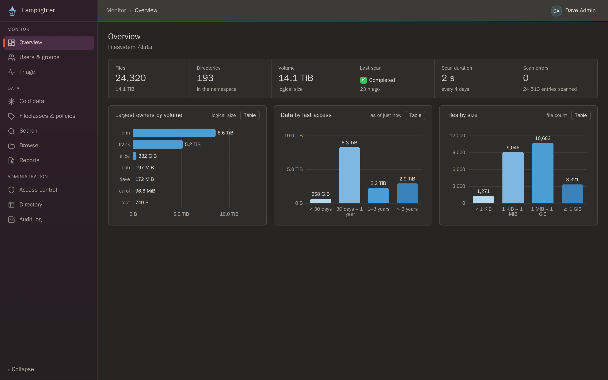
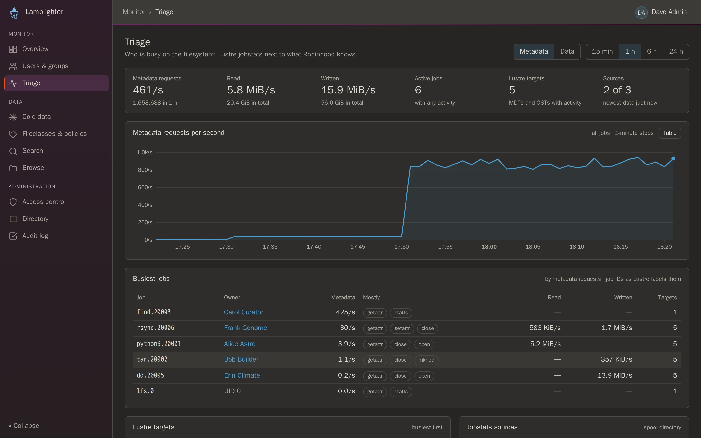
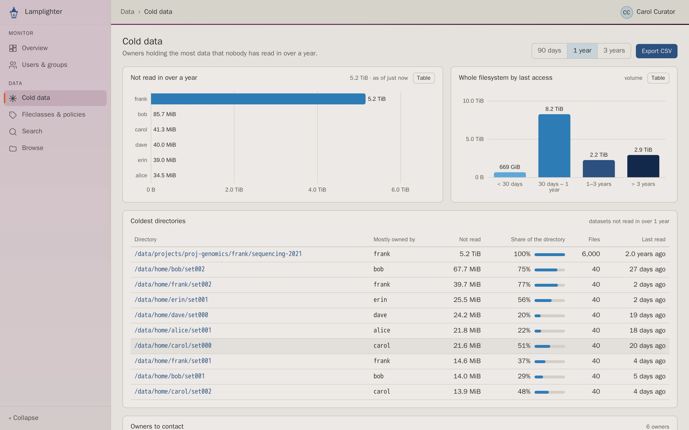
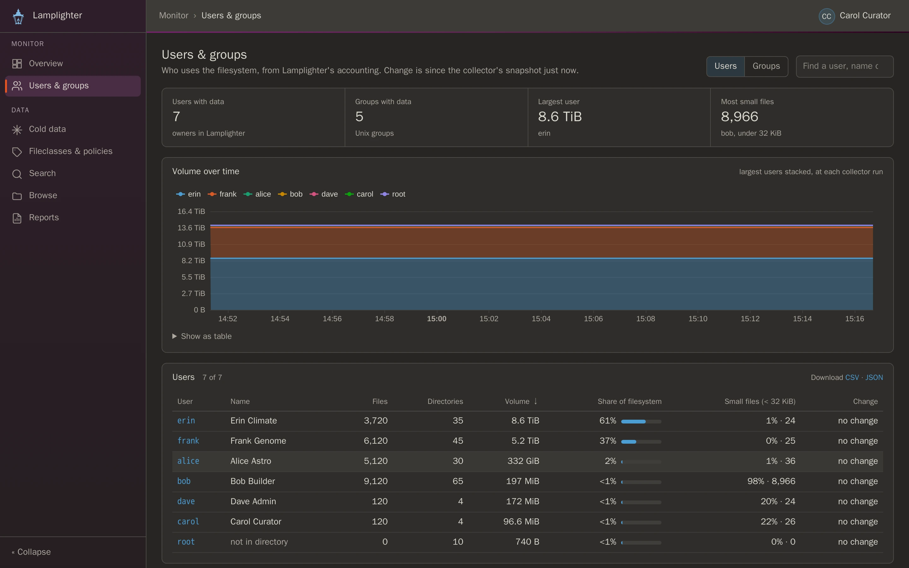
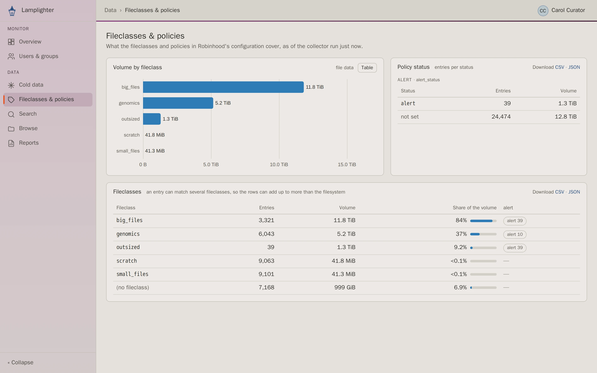
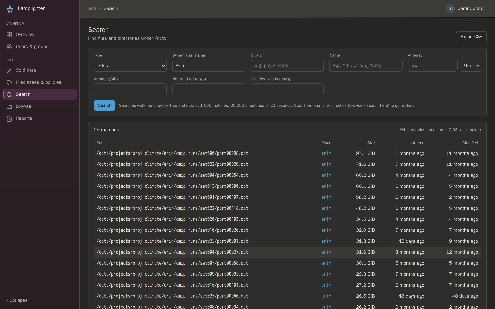
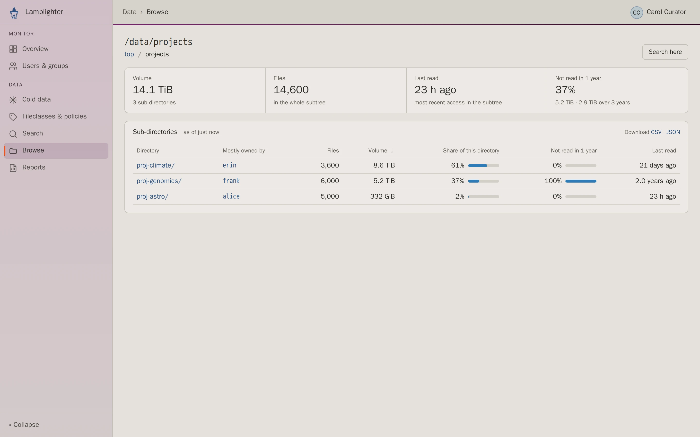
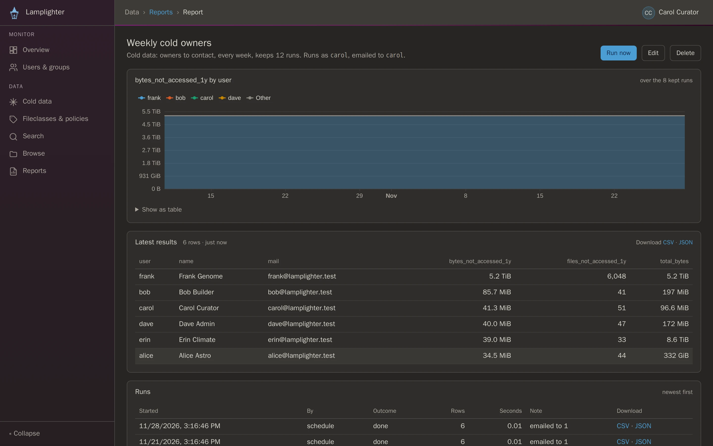
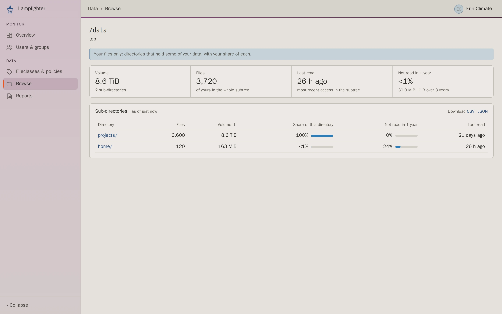
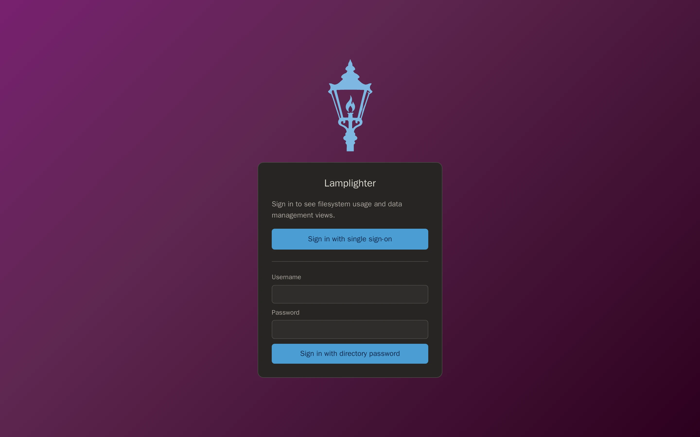

<p align="center">
  <picture>
    <source media="(prefers-color-scheme: dark)" srcset="webui/design/logo/dist/lamplighter-blue-on-dark.png">
    
  </picture>
</p>

<h1 align="center">Lamplighter</h1>

<p align="center"><em>Shedding light on your Lustre filesystem, beautifully.</em></p>

Lamplighter is a policy engine and metadata mirror for large Lustre and POSIX filesystems. It keeps a copy of a filesystem's metadata in a MariaDB or MySQL database, runs attribute-based policies over it (purge, archive, rmdir, checksum and more), provides fast `find` and `du` tools, and shows administrators and data managers what is on their filesystem, who owns it, and how old it is.

**Lamplighter is a fork of the [Robinhood Policy Engine](https://github.com/cea-hpc/robinhood)**, created by CEA in France. The engine at its heart is Robinhood's, and we intend to keep it that way.

> **Status: Lamplighter 1.0.0, the first release.** The web UI is feature-complete with Robinhood's PHP GUI, and the engine is Robinhood 3.2.0's, under Lamplighter's names (`lamplighter`, `lamplighter-*`, `lux-find`, `lux-du`). Scale has so far been measured only in a development environment, and the Checkmk plugin has not yet run on a live site. See [Status](#status) and the [release notes](doc/RELEASE-NOTES.md).

## Standing on the shoulders of Robinhood

Lamplighter exists because Robinhood is excellent.

Robinhood was written at **CEA** (the French Alternative Energies and Atomic Energy Commission), at CEA/DAM, to look after some of the largest filesystems in the world. Its authors designed it from the start to do everything in parallel, so it scans hundreds of millions of entries, follows the Lustre MDT changelog in near real time, and applies policies to petabytes of data. For nearly two decades (its copyright notices start in 2004) it has quietly done this job at HPC centres around the world, and it was given away under a free license for anyone to use.

Our thanks go first to **Thomas Leibovici**, Robinhood's principal author, whose hand is on most of its history. We also thank **Frank Zago** and **Davide Tacchella** of Cray, and **Dominique Martinet**, **Antoine Obert**, **Jerome Andrieu**, **Henri Doreau**, **Kilian Cavalotti**, **Quentin Bouget**, **Guillaume Courrier**, **Maxime Cottret**, **Aurelien Degremont** and every other one of Robinhood's more than forty named contributors. Their work is preserved here in full: this repository carries Robinhood's complete git history, and every commit keeps its author.

Robinhood's copyright notices (CEA/DAM, Cray Inc.) and its CeCILL-C license stay in place on all the code they cover. Fixes we make that would help Robinhood's users too are offered back to CEA.

## Our promise: Lamplighter stays compatible with Robinhood

As a firm project goal, and out of respect for Robinhood, **a site running Robinhood can try Lamplighter, and go back, without converting anything.**

- **The database is unchanged.** Lamplighter uses Robinhood 3's database schema and data structures exactly as they are: the same tables, columns, triggers and stored functions. The same configuration produces the same schema in either program. We will not change them.
- **Configuration files work unchanged.** Copy `/etc/robinhood.d/my-lustre-fs.conf` to `/etc/lamplighter.d/my-lustre-fs.conf` and it works: same syntax, same policies, same module names, same standard include files.
- **Renamed helper programs are handled for you.** If a policy action runs a helper that Lamplighter renamed, Lamplighter uses the new name and logs a clear warning, and `lamplighter-config check` helps you tidy your configuration once.
- **Old command names are available.** The optional `lamplighter-compat` package provides `rbh-find`, `rbh-report` and the other old names, so existing scripts and cron jobs keep running.

### Trying Lamplighter on a copy of your Robinhood database

1. `mysqldump` your Robinhood database and restore it on a test node: a Lustre client configured like your production Robinhood host, with the same filesystem mounted.
2. Install Lamplighter, copy your configuration file into `/etc/lamplighter.d/`, and point it at the restored database.
3. Explore with the read-only tools and the web UI.

> [!WARNING]
> **The test node shares your production filesystem.** Never read the MDT changelog with your production Robinhood's reader ID (usually `cl1`): reading clears records, and your production Robinhood would silently miss them. And never run real policies on the test node: a purge there deletes **real files**. Use dry-run modes only.

The full contract, including exactly how renamed commands in configuration files are handled, is in [doc/COMPATIBILITY.md](doc/COMPATIBILITY.md).

## Why a new name?

**Because Lamplighter is going in its own direction, and that shouldn't be blamed on Robinhood.** A fork that keeps its parent's name causes confusion: users can't tell which project a bug report, a package or a piece of advice belongs to. Robinhood's name and reputation belong to CEA and its community. A new name keeps that clear, and lets Robinhood's users choose either project knowing exactly what each one is.

**And because a new name lets us say what the tool is for.** Today "Robinhood" first brings to mind a stock-trading app. We wanted a name that carries the idea at the heart of the tool: **light**. Lustre means shine. The real value of this software is that it *illuminates* a filesystem: who owns what, how old it is, where the space is going, and what can safely go.

**The lamplighter** was the person who walked the streets at dusk lighting the lamps, so people could see their way, and put them out again at dawn. The software does the same rounds:

| The lamplighter… | Lamplighter… |
|---|---|
| walks the same rounds every night | scans the filesystem and follows the Lustre changelog |
| lights the lamps so people can see the street | gives admins reports, `find`/`du` tools and a web UI to see the filesystem |
| puts out the lamps at dawn | runs purge policies to clear what is no longer needed |
| tends the city's lights | looks after shared storage |

There is a French connection too: the lamplighter (*l'allumeur de réverbères*) is one of the best-loved characters in Saint-Exupéry's *Le Petit Prince*, a fitting nod to Robinhood's French origins.

**Tools for every user carry the prefix `lux-`**, Latin for *light*: `lux-find` and `lux-du`, installed in `/usr/bin`. Everything else carries the project's own name, following Unix's `bin`/`sbin` split: the daemon `lamplighter` (run as `lamplighter@<fsname>.service`) and the administration tools in `/usr/sbin`, `lamplighter-report`, `lamplighter-config` and the rest.

**And a second story, from Rome:** once the census of the whole people was complete, a censor performed the *lustrum*, the purification of the people. First you count everything, then you purify. Lamplighter works the same way: it takes a census of the filesystem into a database, then runs policies over what it found. *Lustrum* is also an ancestor of the word "lustre". The whole naming discussion is in [doc/NAMING.md](doc/NAMING.md).

## What Lamplighter sets out to do

### A look at the web interface

<p align="center"></p>
<p align="center"><em>Overview: the filesystem at a glance, from Robinhood's own accounting.</em></p>

<table>
  <tr>
    <td width="50%"><br>
      <b>Triage.</b> When the filesystem is slow: the busiest jobs from Lustre jobstats, their owners and what they are doing. No job scheduler required.</td>
    <td width="50%"><br>
      <b>Cold data.</b> For data managers: who holds data nobody has read in a year (or three), the coldest datasets, and an export of owners to contact.</td>
  </tr>
  <tr>
    <td><br>
      <b>Users &amp; groups.</b> Usage per owner and group, with names from your directory, small-file counts and change since the last snapshot.</td>
    <td><br>
      <b>Fileclasses &amp; policies.</b> What each fileclass in your Robinhood configuration covers, and how many entries each policy has classified.</td>
  </tr>
  <tr>
    <td><br>
      <b>Search.</b> Find files by owner, group, name, size or age within any directory tree, and export the results.</td>
    <td><br>
      <b>Browse.</b> Walk the tree with subtree totals: volume, files, last access and the share not read in a year.</td>
  </tr>
  <tr>
    <td><br>
      <b>Reports.</b> Any table on a schedule, kept as a history with stacked graphs, downloadable as CSV or JSON, and emailed only to people allowed to see it.</td>
    <td><br>
      <b>Your own files.</b> Regular users browse just their own data: their totals, their files, and nobody else's names.</td>
  </tr>
</table>

<p align="center"><br>
<em>Sign in with single sign-on (Keycloak) or your directory password. Dark and light themes; every page also works on a phone.</em></p>

<sub>Screenshots from the development environment's sample data; regenerate them with <code>webui/devenv/devenv.sh docshots</code>.</sub>

### Keep the engine, modernize everything around it

Robinhood's scanner, changelog reader, pipeline and policy engine are proven at very large scale. We trust them, and we change them only when there is no other way. Lamplighter's work happens *around* the engine, in a new web interface, integrations, packaging and tooling, so improvements never put the core at risk.

Lamplighter continues the **Robinhood 3** line, on **MariaDB and MySQL**. Administrators who know these databases well can keep using what they know, at the scale of tens of petabytes.

### A web interface that a hardened site can actually run

Robinhood's web GUI is written in PHP. PHP is not forbidden anywhere, but at many sites it is costly to run: security teams treat it as an elevated risk, a server that runs it draws closer scrutiny from continuous monitoring (in US federal agencies, for example, CISA's Continuous Diagnostics and Mitigation program, CDM), and every finding on it has to be tracked and patched. Lamplighter keeps PHP off your servers altogether and replaces the GUI entirely:

- **No PHP, anywhere.** A Python (FastAPI) back end and a React front end, packaged as an RPM for Rocky Linux / RHEL 9, behind nginx.
- **It reads Robinhood's database as it is**, with no engine changes. A separate collector does the heavy aggregation, once per run, into the UI's own schema, so the interface stays fast however large the filesystem is.
- **Information-dense and calm to look at.** Dashboards, sortable tables and drill-down from filesystem to user to directory. Dark-first, with a light theme that has no glaring white. Every view is a whole page with its own URL. No HTML frames, ever.

### Real users, real identities, real permissions

A tool that shows who owns every file on a shared filesystem needs proper access control, from the start:

- **Single sign-on with OpenID Connect**, against Keycloak, or an optional direct LDAP bind.
- **Identity and groups come from your directory:** LDAP over TLS only, with configurable base DNs and filters, and both RFC 2307 and RFC 2307bis.
- **Permissions are granted to roles, and roles to LDAP groups.** They are enforced in the API, not just hidden in the interface, and every sign-in and sensitive view is audited.

### Insight operations staff need

- **Cold data, for data managers:** the oldest, largest and least-used files and directories, and the **owners to contact**, as candidates to purge or move to cold storage such as an archive tier or cloud cold storage. This supports data-retention mandates without anyone writing SQL.
- **"Why is the cluster slow?" triage** (planned): what data is hot, by user, group and directory, and which jobs are doing the most I/O. Robinhood sees only metadata, and Lustre updates access times lazily, so real per-job I/O will come from **Lustre jobstats** shown alongside it. No job scheduler is required, and no extra infrastructure: each Lustre server's jobstats arrive through a simple spool directory, or from Prometheus if a site already runs it.

### One alerting tool: yours

**Lamplighter never raises alerts.** No alert mail, no syslog alerts, no red-amber-green states in the interface. Fault detection and alerting belong in your monitoring system, and two alerting systems are one too many. (Scheduled reports can email their results to the people allowed to see them. That is information for people, not an alert.)

Instead, Lamplighter exposes read-only metrics (its own health, scan and changelog status, usage, and match counts per policy and fileclass) through a monitoring API. A **Checkmk** plugin (special agent, checks and rulesets for Checkmk 2.5) polls that API from the Checkmk server, with nothing installed on the Lamplighter host. All thresholds live in Checkmk. Robinhood's alert policies are still useful as classifiers, whose counts Checkmk can watch.

### Modern, maintainable tooling

Perl build helpers are being replaced with Python, and the kernel's `checkpatch.pl` with `clang-format`. Everything is packaged and tested in a reproducible container development environment (Rocky Linux 9, MariaDB, OpenLDAP and Keycloak, all with TLS).

## Status

**Lamplighter 1.0.0** is the first release: see the [release notes](doc/RELEASE-NOTES.md).

| Area | Where it stands |
|---|---|
| Policy engine, scanner, changelog reader, `find`/`du`/`report` tools | Robinhood 3.2.0's engine, unchanged, under Lamplighter's names. |
| Rename to Lamplighter (`lamplighter`, `lamplighter-*`, `lux-find`/`lux-du`, `/etc/lamplighter.d`, packages, `lamplighter-compat`) | Done, following [doc/COMPATIBILITY.md](doc/COMPATIBILITY.md). Upgrading over installed Robinhood RPMs and the engine's full integration suite still need testing on a Linux host with Lustre. |
| Web UI | Feature-complete with Robinhood's PHP GUI: overview, users and groups, triage with Lustre jobstats, cold data, fileclasses and policies, search, browsing, scheduled reports and graphs, CSV/JSON export, sign-in (OIDC and LDAP), roles and the audit log. |
| Scale | Designed for 5 to 20 billion entries per filesystem; measured so far only in a development environment, up to 10 million entries (see the release notes). |
| Checkmk 2.5 plugin | Built and tested against Checkmk's APIs, not yet run on a live site |
| RPM packaging for Rocky Linux / RHEL 9 | Source RPMs rebuild with `rpmbuild --rebuild`; the engine and web UI packages build and install in a clean Rocky 9.7 container (tested on ARM64; the sources are architecture-neutral) |
| PHP web GUI | Removed. The last copy is kept at the git tag `robinhood-php-gui-final`. |

The design for everything web-related is in [doc/webui-design.md](doc/webui-design.md).

## Building and installing

You build RPMs from a git clone (for 1.0.0, check out the tag `v1.0.0`). Any Rocky Linux or RHEL 9 host can be the build host, x86-64 or ARM. You get a source RPM (SRPM), and `rpmbuild --rebuild` turns it into RPMs for the build host's architecture.

### The engine

```sh
# Build tools. EPEL and CRB provide jemalloc-devel.
sudo dnf install -y git dnf-plugins-core epel-release
sudo dnf config-manager --set-enabled crb
sudo dnf install -y gcc make autoconf automake libtool bison flex glib2-devel libattr-devel \
    mariadb-connector-c-devel jemalloc-devel rpm-build systemd-rpm-macros

git clone https://github.com/jonathanmills/lamplighter.git
cd lamplighter
sh autogen.sh
./configure --enable-dist
make srpm                        # rpms/SRPMS/lamplighter-<version>.src.rpm

# On this or any other build host:
sudo dnf builddep rpms/SRPMS/lamplighter-*.src.rpm
rpmbuild --rebuild rpms/SRPMS/lamplighter-*.src.rpm     # RPMs in ~/rpmbuild/RPMS/<arch>/
```

This builds the POSIX packages: `lamplighter-posix`, `lamplighter-adm` (`lamplighter-config`), `lamplighter-tests` and `lamplighter-compat` (Robinhood's command names, only if you need them). For Lustre, add `--with lustre` to `rpmbuild --rebuild` on a host with the Lustre client and its development package; the Lustre build has not been tested in this project's own environment yet.

Then install the packages, create the database (`lamplighter-config create_db`), put your configuration in `/etc/lamplighter.d/<fsname>.conf` (templates are in `/etc/lamplighter.d/templates/`, and a Robinhood configuration works unchanged), and start `lamplighter@<fsname>.service`. Robinhood's installation guide covers the details: [doc/ROBINHOOD-README.md](doc/ROBINHOOD-README.md), with Lamplighter's names (`lamplighter` for `robinhood`, `lamplighter-report` and friends for `rbh-report` and friends, `lux-find`/`lux-du` for `rbh-find`/`rbh-du`, `/etc/lamplighter.d` for `/etc/robinhood.d`).

### The web UI

```sh
make webui-srpm                  # or webui/packaging/make-srpm.sh: needs only rpm-build and tar

sudo dnf module enable -y nodejs:22    # the build needs Node.js 18 or newer; Rocky 9's default is 16
sudo dnf builddep webui/packaging/dist/lamplighter-webui-*.src.rpm
rpmbuild --rebuild webui/packaging/dist/lamplighter-webui-*.src.rpm
```

Node.js is needed only on the build host, to build the front end once; the servers that run Lamplighter never need it, nor PHP. The build downloads Python and npm packages, so the build host needs internet access (or local mirrors). Configuration, nginx and the systemd units are described in [webui/packaging/README.md](webui/packaging/README.md).

### Developing

To work on the web UI, the Checkmk plugin or the packaging, use the container development environment (it also runs on macOS with Podman):

```sh
webui/devenv/devenv.sh all
```

See [webui/devenv/README.md](webui/devenv/README.md).

## Repository layout

| Path | Contents |
|---|---|
| `src/` | The Robinhood engine, daemon and command-line tools (C) |
| `webui/backend/` | Web UI back end and collector (Python, FastAPI) |
| `webui/frontend/` | Web UI front end (React, TypeScript) |
| `webui/checkmk/` | Checkmk 2.5 plugin |
| `webui/packaging/` | RPM, systemd and nginx packaging for the web UI |
| `webui/devenv/` | Container development and test environment |
| `webui/design/` | Color palette and logo |
| `doc/` | Design documents, the compatibility promise, the naming discussion and the original Robinhood README |
| `tests/test_suite/` | Robinhood's integration tests |

## License

- **Code from Robinhood**, and changes to it, are under the **[CeCILL-C](http://www.cecill.info/licences/Licence_CeCILL-C_V1-en.html)** license, a French free-software license compatible with the GNU LGPL.
  Copyright (C) 2004-2017 CEA/DAM. Copyright 2013-2016 Cray Inc. All Rights Reserved.
- **New code under `webui/`** (the web UI, collector, Checkmk plugin and packaging) is under the **GNU General Public License, version 2 or later** ([webui/LICENSE](webui/LICENSE)). Each file carries an `SPDX-License-Identifier`.
- **The logo** is derived from a photograph by Jonathan Mills, stylized with Google Gemini. See [webui/design/logo/README.md](webui/design/logo/README.md).

Lamplighter is an independent project. It is not affiliated with or endorsed by CEA, by the Robinhood project, or by Checkmk GmbH. *Lustre* is a trademark of its owner, and *Checkmk* is a trademark of Checkmk GmbH.

## Supporting Lamplighter

Lamplighter is free software, and it always will be. Building it isn't free, though: it takes time, test systems and development tools. If Lamplighter has earned a place in your work and you're feeling appreciative, a contribution through [PayPal](https://paypal.me/JonathanMills1979) is gratefully received, and helps keep the lamp lit. Thank you.
